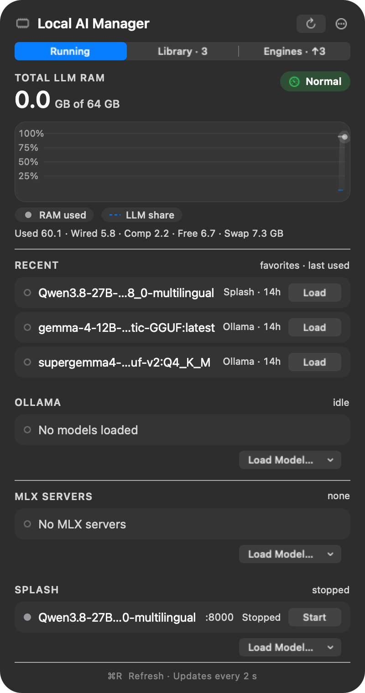
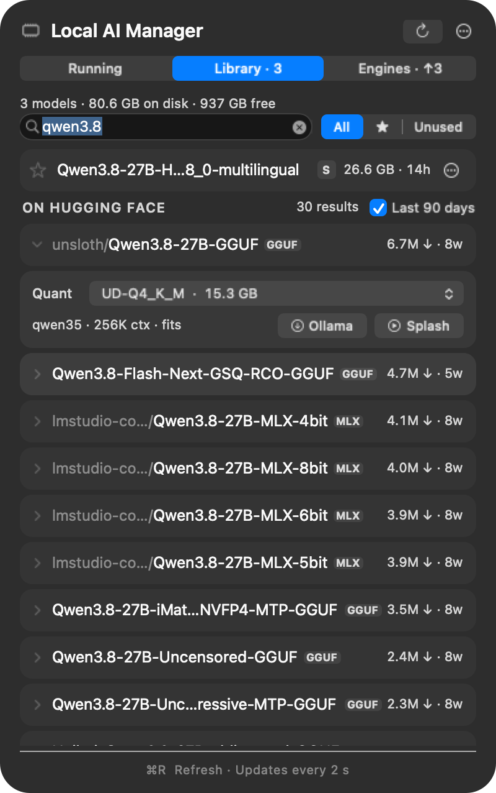
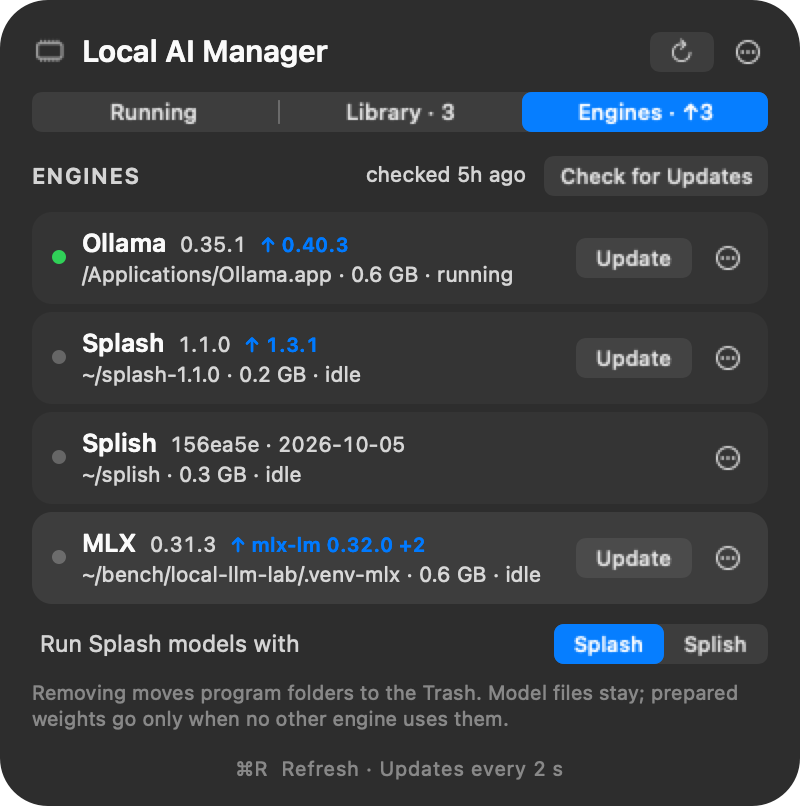

# Local AI Manager

A macOS menu-bar app for the local LLMs on your Mac. It shows what is loaded and how much RAM it takes, and it lets you load, favorite, download and safely delete models across **Ollama**, **MLX** and **[Splash](https://github.com/incoai/splash)** (or its M5-tuned fork **[Splish](https://github.com/publicExcess/splish)**) from one list. It also installs, updates and removes the engines themselves.

<p>
  
  
  
</p>

## What it does

**Running**
- Total RAM used by local models, with a memory-pressure graph and the RAM, swap and compressed breakdown.
- Loaded models per backend with their size, plus unload, start, stop and switch.
- A *Recent* strip of favorites and recently used models, for one-click loading.

**Library**
- Every model on disk in one list, merged across Ollama, the Hugging Face cache (MLX) and Splash installs. A model stored by several backends appears once.
- Favorites (★), search, and an *Unused* filter.
- **Safe delete.** It shows exactly how much space a delete frees and asks for confirmation inline. It refuses to delete a model that is loaded, being served, or used by a LaunchAgent or a configured server.
- Disk total that counts APFS clones once, and a warning when the same weights are stored twice.
- **One search for your models and Hugging Face's.** Typing filters what's on disk; after a short pause (or Return) the same search runs on Hugging Face for GGUF and MLX text models, listed below your own with an *on disk* mark on repos you already have.
- Click a result to pick a quantization and see whether it fits in your RAM. GGUF models go to Ollama (`hf.co/…` pulls) or to Splash; MLX models are downloaded into the Hugging Face cache and served with `mlx_lm` / `mlx_vlm`. Progress shows at the top of the tab and in its title.

**Engines**
- Ollama, Splash, Splish and MLX with their installed version, size and location, and whether a newer release is out. The tab shows *Engines · ↑N* when updates are waiting. It checks GitHub, PyPI and Splish's git remote twice a day, or on demand.
- **Install** and **Update** in one click, with progress in the row. See [Engines: install, update, remove](#engines-install-update-remove).
- **Remove**, with an inline confirmation that lists what goes to the Trash, which prepared weights are deleted, and which background servers change.
- Which engine runs Splash models, when both Splash and Splish are installed.

A history of loads, unloads, downloads, deletes and engine changes is kept locally.

## Requirements

- A Mac with Apple silicon, running **macOS 26** or later.
- Xcode Command Line Tools, to build: `xcode-select --install`.
- At least one backend. You can install any of them from the **Engines** tab later:
  - [Ollama](https://ollama.com), running on the default port 11434.
  - [Splash](https://github.com/incoai/splash): the `splash` CLI in `~/.local/bin` or Homebrew.
  - [Splish](https://github.com/publicExcess/splish), the community fork of Splash tuned for M5 GPUs: a built checkout in `~/splish` (or see [Splash and Splish](#splash-and-splish)).
  - MLX: a Python environment with `mlx-lm` (optionally `mlx-vlm`) and `huggingface_hub`. See [MLX setup](#mlx-setup).

  The MLX and Splash sections only appear when that backend is installed.

## Install

```sh
git clone https://github.com/Inselite/local-ai-manager.git
cd local-ai-manager
./scripts/install.sh
```

This builds the app, copies it to `~/Applications/Local AI Manager.app`, and adds a LaunchAgent so it starts at login and restarts if it crashes. Quitting from the menu keeps it quit until the next login. Look for the memory-chip icon in the menu bar.

To update, run `git pull` and then `./scripts/install.sh` again. To remove it, run `./scripts/uninstall.sh`; your models are not touched.

## MLX setup

The app needs to know which Python environment has MLX. It looks in this order:

1. The `mlxBinDir` setting:
   ```sh
   defaults write io.github.inselite.LocalAIManager mlxBinDir ~/path/to/venv/bin
   ```
2. The folder of the first server in `mlx_servers.json` (see below).
3. `~/.venv-mlx/bin`, `~/.venv/bin`, `~/mlx/bin`, or a pipx `mlx-lm` install.

To create one, click **Install** next to MLX in the Engines tab, or by hand:

```sh
python3 -m venv ~/.venv-mlx
~/.venv-mlx/bin/pip install mlx-lm mlx-vlm huggingface_hub
```

## Splash and Splish

Splish is a full fork of Splash, so you need only one of them. The app supports both, side by side:

- Run from its checkout, Splish keeps its installs in `<checkout>/install/models`, apart from Splash's
  `~/Library/Application Support/Splash/models`. The Library lists both and labels Splish copies.
  Both share the Hugging Face cache, so a model in both stores is downloaded once. The prepared
  weights in `~/Library/Caches/Splash/weights` are keyed by content, so both engines use the same
  copy as long as they prepare the same format. Splish adds small prepared copies of its draft models.
- A model installed in only one of them always runs with that one. For anything else, pick the
  engine in the Engines tab (*Run Splash models with Splash / Splish*), shown when both are installed.
- LaunchAgents and processes running `splish serve` show up like Splash servers.

The app looks for the checkout in `~/splish`, `~/src/splish`, `~/Developer/splish`, `~/code/splish`,
`~/projects/splish`, `~/git/splish` and `~/GitHub/splish`, or wherever you point it:

```sh
defaults write io.github.inselite.LocalAIManager splishDir ~/path/to/splish
```

## Engines: install, update, remove

| Engine | Install | Update | Remove (to the Trash) |
|---|---|---|---|
| Ollama | Downloads `Ollama-darwin.zip` from GitHub into `/Applications` | Same: checks that the new app is signed by Ollama (Team ID `3MU9H2V9Y9`), quits Ollama, swaps the app and starts it again. Loaded models unload. | `Ollama.app`. Models stay in `~/.ollama`. |
| Splash | Downloads the release tarball, checks its SHA-256, unpacks it to `~/splash-<version>` and writes the `splash` command in `~/.local/bin` | Same, then moves the old release folder to the Trash. Homebrew installs run `brew upgrade`. | The release folder, the `splash` command and `~/Library/Application Support/Splash` |
| Splish | `git clone` into `~/splish`, then builds it (needs Xcode; fetches the Metal toolchain if missing) | `git pull --ff-only`, then rebuilds | The checkout |
| MLX | Creates `~/.venv-mlx` with `uv` (or `python3 -m venv`) and installs `mlx-lm`, `mlx-vlm`, `huggingface_hub` | Upgrades the installed `mlx-lm`, `mlx-vlm` and `mlx` with `uv pip` or `pip` | The environment (only if it is a real venv) |

- Model files in the Hugging Face cache are never removed with an engine. Removing Splash or Splish unlinks the models in its own store and deletes the prepared weights that only it used.
- LaunchAgents that ran the removed engine are switched to the other one (Splash ↔ Splish) when it is installed. If it isn't, the confirmation warns that they will stop working.
- Nothing runs while that engine is serving a model or another engine job is running. The row says what's in the way.
- Engines installed some other way (for example a custom wrapper) are shown, but not updated or removed.
- The output of the last job is in `/tmp/local-ai-manager-engine.log` (*Show Last Install Log* in the row's ⋯ menu).

Splash 1.3 no longer loads Splash-format "packages"; GGUF models work as before. After updating one of Splash or Splish, the two may prepare different weight formats, so switching engines can prepare the weights again.

### Your own MLX servers

Servers you want listed (and startable) go in `~/Library/Application Support/Local AI Manager/mlx_servers.json`:

```json
[
  {
    "name": "Qwen3 8B",
    "port": 8080,
    "binary": "/Users/you/.venv-mlx/bin/mlx_lm.server",
    "args": ["--model", "mlx-community/Qwen3-8B-4bit", "--port", "8080"]
  }
]
```

The app adds its own entry (`"panel": true`, port 8081) when you load an MLX model from the menu. It leaves hand-written entries alone.

## Where things are stored

| What | Where |
|---|---|
| Favorites, usage stats, history, MLX servers | `~/Library/Application Support/Local AI Manager/` |
| Settings (tab, *Last 90 days*, `mlxBinDir`, `splishDir`, `splashEngine`) | `defaults read io.github.inselite.LocalAIManager` |
| App log | `/tmp/local-ai-manager.log` |
| Engine install and update output | `/tmp/local-ai-manager-engine.log` |
| Splash model started from the app | LaunchAgent `io.github.inselite.LocalAIManager.splash`, log `/tmp/local-ai-manager-splash.log` |

The app has no telemetry. It only talks to your local backends, to `huggingface.co` (search and downloads), and, for engine updates, to the GitHub and PyPI APIs and the release downloads. If you're logged in with `hf auth login`, your token is read from `~/.cache/huggingface/token` so gated repos work, and it is sent only to huggingface.co.

## Deleting models: what gets removed

- **Ollama:** through Ollama's own API (`DELETE /api/delete`). Ollama removes blobs that no other model uses.
- **Hugging Face cache / MLX:** the repo's folder in `~/.cache/huggingface/hub`.
- **Splash / Splish:** the install's links and resolved folder, its metadata, and the prepared copy of the weights in `~/Library/Caches/Splash/weights`, which neither engine cleans up itself. Files shared with another install (such as a draft model) are kept.

The confirm row lists what will be freed before anything happens.

## Debug flags

```sh
B="$HOME/Applications/Local AI Manager.app/Contents/MacOS/LocalAIManager"
"$B" --dump-library                  # print the Library scan and exit (read-only)
"$B" --dump-engines                  # print engine versions, available updates and what removing Splash/Splish would delete, and exit
"$B" --window --shot out.png 4       # open as a window and save a screenshot after 4 s
"$B" --window --hidpi --shot out.png 4   # same, drawn at 2x (for README images)
"$B" --window --hf-search qwen       # open the Library tab searching for "qwen", first Hugging Face result expanded
```

## Building by hand

Everything is one Swift file, with no Xcode project and no dependencies:

```sh
./scripts/build.sh      # → build/Local AI Manager.app
```

## License

MIT. Splash, Ollama and MLX are separate projects with their own licenses; this app only talks to them.
